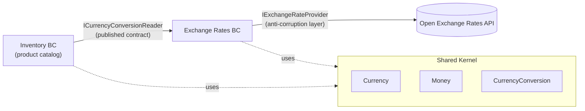
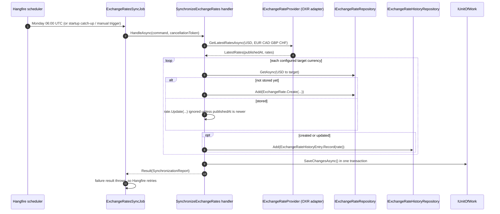
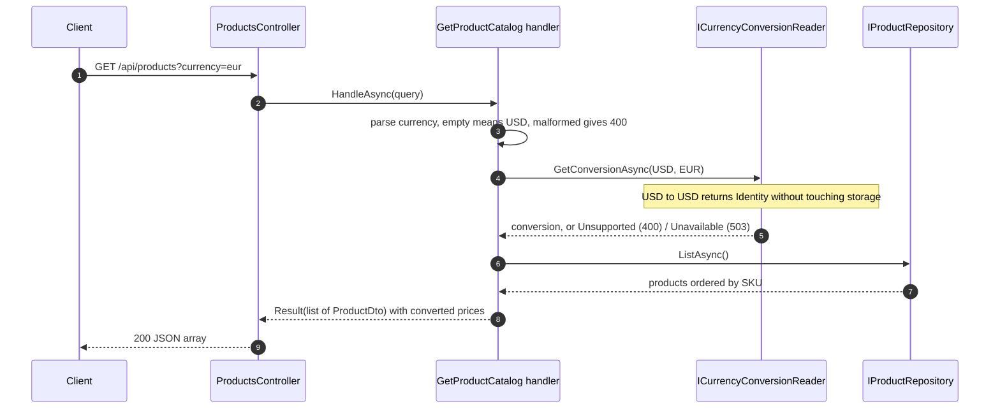

# Design Spec: Exchange Rate Synchronization & Multi-Currency Product Catalog

| | |
|---|---|
| **Status** | Approved |
| **Date** | 2026-10-26 |
| **Covers** | Task 1 (fixes in the path of Tasks 2–3), Task 2, Task 3 |
| **Baseline** | Commit `a456096` (original starter code, unmodified) |
| **Decisions** | [`docs/adr/`](../adr/README.md) |

---

## 1. Context and goals

The platform serves an international customer base. It must keep USD-based exchange rates up to date (Task 2) and expose the product catalog in the customer's preferred currency (Task 3). Task 1 asks for a code analysis of the starter project. Its findings live in [`Task1_CodeAnalysis.md`](../../Task1_CodeAnalysis.md). Only the findings that block or sit directly in the path of Tasks 2–3 are fixed here (see §13).

**Goals**

1. Meet every stated requirement and make every unstated edge case an explicit, tested decision.
2. Apply DDD (bounded contexts, aggregates, value objects, ubiquitous language) and SOLID, kept proportional to the problem size.
3. Leave the system runnable by a reviewer with the README commands exactly as written.

**Non-goals**

Authentication, pagination, caching, domain or integration events, persistent Hangfire storage and multi-instance deployment. These are recorded as recommendations in Task 1 and §15.

---

## 2. Requirements

### 2.1 Functional requirements (from the task statements)

| ID | Requirement | Source |
|---|---|---|
| FR-T1-01 | Document code-analysis findings in `Task1_CodeAnalysis.md` | Task 1 |
| FR-T2-01 | Integrate with the Open Exchange Rates (OXR) API | Task 2 §1 |
| FR-T2-02 | Fetch rates for **EUR, CAD, GBP, CHF** | Task 2 §2 |
| FR-T2-03 | Use **USD** as the base currency | Task 2 §2 |
| FR-T2-04 | Run automatically **every Monday** as a Hangfire recurring job | Task 2 §3 |
| FR-T2-05 | Persist rates in SQLite; the **latest** rate per currency is **updated** | Task 2 §4 |
| FR-T2-06 | Every fetched rate is **historically logged** | Task 2 §4 |
| FR-T3-01 | `GET /api/products` lists the entire catalog | Task 3 §1 |
| FR-T3-02 | Optional `currency` query parameter | Task 3 §1 |
| FR-T3-03 | No currency → prices in the base currency (USD) | Task 3 §2 |
| FR-T3-04 | Supported currency → price converted with the **latest stored** rate | Task 3 §2 |
| FR-T3-05 | Each item states its currency (`{ "sku", "price", "currency" }`) | Task 3 §2 |

### 2.2 Derived requirements (edge cases the tasks leave open)

| ID | Requirement |
|---|---|
| DR-01 | A malformed or unsupported `currency` returns **400** ProblemDetails that lists the supported currencies |
| DR-02 | A supported currency with no stored rate yet returns **503** ProblemDetails |
| DR-03 | `currency` is trimmed and case-insensitive. Absent or empty means USD. Explicit `USD` returns base prices without reading rates |
| DR-04 | Converted amounts are rounded **once**, to the currency's ISO 4217 minor units (2 for every supported currency), **half away from zero**. Amounts always serialize with exactly those decimals (`95.50`, never `95.5`) |
| DR-05 | Sync is **idempotent**. A run whose provider timestamp is not newer than the stored one changes nothing and adds no history |
| DR-06 | Sync is **atomic**. Current rates and history entries commit in one transaction |
| DR-07 | Partial provider response: currencies present are applied and missing ones are logged as warnings. If none can be applied, the run fails, so Hangfire retries it |
| DR-08 | On startup, one sync is enqueued immediately when a supported currency has no stored rate or one older than a schedule period. This covers a fresh database, a newly configured currency, and a Monday run missed while the app was down (configurable) |
| DR-09 | The OXR App ID is never committed and never appears in URLs or logs |
| DR-10 | `GET /api/products/{sku}` for an unknown SKU returns **404** (baseline: 500 with stack trace) |
| DR-11 | Sync runs never overlap |
| DR-12 | Transient provider failures are retried at the HTTP level (seconds) and the job level (5 attempts over about 4 hours) |

### 2.3 Non-functional requirements

| ID | Requirement |
|---|---|
| NFR-01 | `dotnet build` and `dotnet test` succeed **from the repository root**, as the README states (baseline: `MSB1003`) |
| NFR-02 | The build is free of warnings at delivery. Warnings are not escalated to errors, so a NuGet advisory published after delivery cannot break a reviewer's build |
| NFR-03 | Money and rates are `decimal` end to end (JSON → domain → database, stored as exact TEXT in SQLite). No `double` anywhere |
| NFR-04 | Dependency rule: Domain → nothing; Application → Domain; Infrastructure → Application; Api is the composition root |
| NFR-05 | Unexpected errors return 500 ProblemDetails with a `traceId` and no stack trace outside Development |
| NFR-06 | Automated tests never call the live OXR API |
| NFR-07 | No known-vulnerable packages (baseline: 8 × NU1903) |

---

## 3. Assumptions and interpretations

| ID | Statement | Rationale |
|---|---|---|
| A-01 | Task 3's dependency on "Task 1 (Exchange Rate Synchronization)" means **Task 2** | The title in parentheses names Task 2 |
| A-02 | "Either updated and historically logged" means **both** | Only reading that satisfies both verbs. A current-state table plus a history log satisfies either reading |
| A-03 | Stored product prices are in **USD** | Task 3: "return the product prices in their base currency (USD)" |
| A-04 | "Every Monday" means **Monday 06:00 UTC**, with cron and time zone configurable | FX markets reopen Sunday ~22:00 UTC, so Monday-morning rates reflect the new week rather than Friday's close |
| A-05 | "Latest available rate" is ordered by the **provider's publication timestamp**, not by retrieval time | Retrieval time says nothing about the rate's freshness |
| A-06 | Rounding follows each currency's ISO 4217 minor units | All required currencies (USD, EUR, CAD, GBP, CHF) have 2; `Currency` also knows the exceptions (JPY 0, KWD 3, …) |

---

## 4. Domain model

### 4.1 Bounded contexts



- **Inventory** (existing module name, kept to avoid churn) owns `Product`. It never sees the Exchange Rates aggregates or repositories. It asks the published contract for a `CurrencyConversion` value, and for the list of supported currencies used in error messages ([ADR-0002](../adr/0002-shared-kernel-and-conversion-contract.md)).
- **Exchange Rates** owns rate state and its history, and translates the provider's model at the boundary.
- The **Shared Kernel** holds only the concepts both contexts genuinely share: `Currency`, `Money`, `CurrencyConversion`.

### 4.2 Building blocks and invariants

| Type | Kind | Context | Invariants / behavior |
|---|---|---|---|
| `Currency` | Value object | Shared | ISO 4217 format: exactly 3 ASCII letters, normalized to upper case. `TryParse` for user input. `MinorUnits` per ISO 4217 (2 by default) |
| `Money` | Value object | Shared | `Amount` (`decimal`) + `Currency`. Equality by value. `RoundToMinorUnits()` is the single rounding rule (DR-04) |
| `CurrencyConversion` | Value object | Shared | `From`, `To`, `Rate > 0`, `AsOf` (provider publication time; `null` for identity). `Convert(Money)` requires `money.Currency == From`. Returns `Money(round(amount × rate), To)` per DR-04. `Identity(c)` has rate 1 |
| `Sku` | Value object | Inventory | Non-empty, trimmed, ≤ 64 chars |
| `Product` | Aggregate root | Inventory | `Sku` (identity), `Name` (non-empty, ≤ 200), `Price: Money` with amount ≥ 0 and currency = catalog base (USD). Private setters; created through a factory |
| `CurrencyPair` | Value object | Exchange Rates | `Base ≠ Quote` |
| `ExchangeRate` | Aggregate root | Exchange Rates | Identity = `CurrencyPair`. `Rate > 0`, `PublishedAt`, `RetrievedAt`. `Update(rate, publishedAt, retrievedAt)` applies only when `publishedAt` is strictly newer, otherwise reports *ignored*. `ToConversion()` |
| `ExchangeRateHistoryEntry` | Entity (append-only) | Exchange Rates | Immutable snapshot of a rate at `PublishedAt`. Created only from an `ExchangeRate` that was just created or updated |

**Repositories** (interfaces in Domain, never call `SaveChanges`):

- `IProductRepository`: `GetBySkuAsync` (returns `null` when absent), `ListAsync` (ordered by SKU).
- `IExchangeRateRepository`: `GetAsync(pair)`, `ListAsync` (every current rate), `Add`.
- `IExchangeRateHistoryRepository`: `Add`.

**Rate direction.** OXR quotes "1 USD = *r* units of the target". The converted price is therefore `priceUsd × r`. A dedicated test pins this ([ADR-0008](../adr/0008-monetary-precision-and-rounding.md)).

---

## 5. Architecture

### 5.1 Projects and folders

The five projects and their folder conventions (`Modules/<Context>`, `Common/`) stay. One project is added: `Demo.IntegrationTests`. The solution file moves to the repository root (NFR-01).

```
DemoSolution.slnx                         (moved from src/)
Directory.Build.props                     shared TFM, Nullable, ImplicitUsings
Directory.Packages.props                  Central Package Management + transitive pinning
src/
  Demo.Domain/
    Common/                               Shared Kernel + building blocks
      Currency.cs  Money.cs  CurrencyConversion.cs  DomainException.cs
    Modules/Inventory/                    Product.cs  Sku.cs  IProductRepository.cs
    Modules/ExchangeRates/                CurrencyPair.cs  ExchangeRate.cs
                                          ExchangeRateHistoryEntry.cs  repository interfaces
  Demo.Application/
    Common/                               IQueryHandler<,>  ICommandHandler<,>  IUnitOfWork
                                          Result<T>  Error  ErrorType
    Modules/Inventory/
      ProductDto.cs
      GetProductBySku/                    query + handler
      GetProductCatalog/                  query + handler
    Modules/ExchangeRates/
      SupportedCurrencies (options)       base USD + configured targets: single source of truth
      Contracts/ICurrencyConversionReader + implementation
      Ports/IExchangeRateProvider         outbound port, LatestRates DTO, provider exception
      SynchronizeExchangeRates/           command + handler + SynchronizationReport
    DependencyInjection.cs                AddApplication()
  Demo.Infrastructure/
    Persistence/                          DemoDbContext (: IUnitOfWork), entity configurations,
                                          repositories, Migrations/, seeding
    ExchangeRates/OpenExchangeRates/      typed HttpClient adapter (ACL) + options
    BackgroundJobs/                       ExchangeRatesSyncJob, ExchangeRatesSyncScheduler (hosted service
                                          that registers the recurring job and the startup catch-up)
    DependencyInjection.cs                AddInfrastructure()
  Demo.Api/
    Controllers/ProductsController.cs
    ErrorHandling/                        Result → ProblemDetails mapping (unhandled exceptions are
                                          covered by the built-in exception handler + AddProblemDetails)
    Program.cs                            composition root only
  Demo.UnitTests/                         Domain + Application
  Demo.IntegrationTests/                  Infrastructure + HTTP API
```

### 5.2 Application style

There is one handler per use case behind `IQueryHandler<TQuery, TResult>` / `ICommandHandler<TCommand, TResult>`, with no mediator library ([ADR-0003](../adr/0003-use-case-handlers-without-mediator.md)). The baseline `IInventoryModule` facade is replaced by `GetProductBySku`. Controllers depend on handler interfaces, and handlers depend on domain ports.

### 5.3 Error model

Expected business outcomes (not found, invalid input, rate unavailable) travel as `Result<T>` carrying an `Error(Code, Message, Type)`. Exceptions are reserved for invariant violations (`DomainException`) and infrastructure failures. The Api maps `ErrorType` to HTTP ([ADR-0006](../adr/0006-error-contract.md)).

---

## 6. Behavior: exchange-rate synchronization (Task 2)

### 6.1 Flow



### 6.2 Rules

| Situation | Outcome |
|---|---|
| Provider answers on a base other than USD | `ExchangeRateProviderException`; nothing is stored (EUR-based values must never become USD rates) |
| Pair not stored | Create the `ExchangeRate` and append a history entry |
| Provider `publishedAt` newer than stored | Update the rate and append a history entry |
| Provider `publishedAt` equal or older | Ignore: no write and no history entry (DR-05). A unique index on history is the safety net |
| Target missing or non-positive in the response | Skip it and log a warning (DR-07) |
| No target could be applied | Handler returns a failure. The job throws and Hangfire retries |
| Provider/network/auth failure | `ExchangeRateProviderException` propagates. Hangfire marks the run failed and retries |
| App ID not configured | Fails before any HTTP call with an explicit message. The API keeps serving (USD works) |

### 6.3 Scheduling ([ADR-0005](../adr/0005-sync-schedule-bootstrap-and-retries.md))

- Recurring job id `exchange-rates-sync`, cron `0 6 * * 1`, time zone `UTC`. Both are configurable.
- It is registered on **every startup** through `IRecurringJobManager.AddOrUpdate`, which is idempotent. This is required because MemoryStorage loses all state on restart.
- `[DisableConcurrentExecution]` prevents overlapping runs (DR-11). `[AutomaticRetry(Attempts = 5)]` with delays of 1 min, 5 min, 15 min, 1 h and 3 h rides out a provider outage of about 4 hours (DR-12). Hangfire's default backoff would give up after about 4 minutes.
- Catch-up: when `CatchUpOnStartup` is true, the scheduler asks the `IsSynchronizationDue` rule, and enqueues one immediate run if a supported currency has no rate or one retrieved more than `StaleAfter` ago (default 7 days) (DR-08). MemoryStorage keeps no execution history, so this is what recovers a Monday run missed during downtime.
- A run can also be triggered manually from the Hangfire dashboard ("Trigger now").
- Hangfire's job cancellation token flows down to the HTTP call and EF.

---

## 7. Behavior: catalog with currency conversion (Task 3)

### 7.1 Flow



The currency is validated and the rate resolved **before** products are loaded, so invalid requests do no catalog I/O. Conversion runs in memory: SQLite cannot compute on `decimal` columns, and the catalog is read in full anyway.

### 7.2 Conversion rule ([ADR-0008](../adr/0008-monetary-precision-and-rounding.md))

```
converted = round(priceUsd × rate, 2, MidpointRounding.AwayFromZero), normalized to scale 2
```

The full-precision rate is used, with a single rounding step at the end. Identity conversion also normalizes the scale, so `103.3` from SQLite serializes as `103.30`.

---

## 8. External integration: Open Exchange Rates ([ADR-0007](../adr/0007-open-exchange-rates-acl-and-secrets.md))

Facts were verified against the official docs on 2026-10-26.

| Aspect | Decision |
|---|---|
| Endpoint | `GET {BaseUrl}latest.json?symbols=EUR,CAD,GBP,CHF` (`symbols` is allowed on the free plan) |
| Auth | Header `Authorization: Token <AppId>`. Never in the query string, so the key cannot leak into URLs or logs |
| Base | `base` is **not** sent: changing it is a paid feature and USD is the default. The adapter reports the response `base`; the sync use case rejects anything but `USD` |
| Timestamp | `timestamp` (UNIX seconds, UTC) → `DateTimeOffset` UTC = `PublishedAt`. A missing or out-of-range timestamp is rejected (it must never become 1970-01-01) |
| Number parsing | `rates` deserialized directly to `decimal` (NFR-03). Null, non-positive or unknown entries are skipped with a warning |
| Transport failures | Network errors, resilience give-ups, `HttpClient.Timeout` and undecodable bodies → `ExchangeRateProviderException`. Caller cancellation propagates unchanged |
| Error body | `{ "error": true, "status", "message", "description" }` → `ExchangeRateProviderException` carrying `message` (e.g. `invalid_app_id`) |
| Resilience | `AddStandardResilienceHandler()`: attempt and total timeouts, exponential retry with jitter on 5xx/408/429 and network errors, circuit breaker. 401/403 are not retried |
| Quota | Free plan: 1,000 requests/month. Expected use: ~5/month. The catalog endpoint **never** calls OXR |

---

## 9. API contract

### 9.1 `GET /api/products`

| Parameter | In | Required | Notes |
|---|---|---|---|
| `currency` | query | no | ISO 4217 code, case-insensitive. Supported: USD, EUR, CAD, GBP, CHF |

`200 OK`, items ordered by SKU. The example uses the baseline seed and an assumed USD→EUR rate of 0.92: `103.30 × 0.92 = 95.036 → 95.04`.

```json
[
  { "sku": "SKU1", "name": "Name", "price": 95.04, "currency": "EUR" },
  { "sku": "SKU2", "name": "Name", "price": 94.02, "currency": "EUR" }
]
```

A plain array keeps faith with "retrieve the entire product catalog" and with the example payload.

### 9.2 `GET /api/products/{sku}`

`200 OK` → `{ "sku", "name", "price", "currency": "USD" }`. Adding `currency` is additive, so it does not break existing clients. `404` when the SKU is unknown.

### 9.3 Error matrix (RFC 9457, `application/problem+json`)

Every problem response carries `status`, a `title` per error type, a human-readable `detail`, a stable machine-readable `code` extension and the `traceId`.

| Condition | Status | `code` | `detail` |
|---|---|---|---|
| `currency` malformed (`EURO`, `12`) | 400 | `currency.invalid` | Names the value and lists supported codes |
| `currency` well-formed but not supported (`JPY`) | 400 | `currency.unsupported` | Names the value and lists supported codes |
| Supported currency, no stored rate | 503 | `exchange_rate.unavailable` | Names the pair (e.g. `USD/EUR`) |
| Unknown SKU | 404 | `product.not_found` | Names the SKU |
| Unhandled exception | 500 | none | Generic message from the framework; no stack trace |

---

## 10. Persistence

The model is current state plus append-only history ([ADR-0001](../adr/0001-exchange-rates-current-state-plus-history.md)). Precisions in parentheses are declared in the EF model through `HasPrecision`.

| Table | Columns | Keys / indexes |
|---|---|---|
| `Products` | `Sku` TEXT, `Name` TEXT(200), `Price` TEXT (decimal 18,2), `PriceCurrency` TEXT(3) | PK `Sku` |
| `ExchangeRates` | `BaseCurrency` TEXT(3), `QuoteCurrency` TEXT(3), `Rate` TEXT (decimal 18,8), `PublishedAt` INTEGER, `RetrievedAt` INTEGER | PK (`BaseCurrency`, `QuoteCurrency`) |
| `ExchangeRateHistory` | `Id` INTEGER, same rate columns as above | PK `Id`; **UNIQUE** (`BaseCurrency`, `QuoteCurrency`, `PublishedAt`) |

- **Decimals.** Precision is declared with `HasPrecision`, never with `HasColumnType("decimal(...)")`.
  - In SQLite, a `decimal(18,2)` column type gets NUMERIC affinity, so the engine silently converts the text EF writes into a binary floating-point REAL. This was verified on the baseline: `typeof(Price) = 'real'`.
  - With `HasPrecision`, EF stores the value as TEXT, which is exact. This was verified with a probe on EF Core 10.0.14.
  - The declared precision still matters for portability: on SQL Server, a `decimal(18,2)` rate column would turn `0.921234` into `0.92`.
- **Timestamps.** `DateTimeOffset` maps to INTEGER (UNIX milliseconds) through a value converter. The EF Core SQLite provider cannot translate ordering or comparison on `DateTimeOffset`.
- **Value objects.** `Currency` and `Sku` map to TEXT through converters. `Money` maps to a complex property (`Price` + `PriceCurrency`).
- **Schema evolution.** EF Core **Migrations** replace `EnsureCreated`, which never adds tables to an existing database ([ADR-0004](../adr/0004-ef-core-migrations.md)). They are applied at startup with `MigrateAsync`. The demo seed (same SKUs and prices as the baseline) moves to EF Core's `UseSeeding`/`UseAsyncSeeding` and stays idempotent.
- **Connection string.** It moves to configuration (`ConnectionStrings:Demo`). The relative path stays: `dotnet run` uses the project folder as the working directory and content root, so `demo.db` lands in `src/Demo.Api` as before (verified).
- **Tooling.** `dotnet-ef` is pinned in a local tool manifest (`dotnet-tools.json`), so `dotnet tool restore` gives every developer the same version.

---

## 11. Configuration and secrets

| Key | Default | Notes |
|---|---|---|
| `ConnectionStrings:Demo` | `Data Source=demo.db` | resolved from the project folder under `dotnet run` |
| `ExchangeRates:TargetCurrencies` | `["EUR","CAD","GBP","CHF"]` | validated at startup: valid codes, distinct, not USD, non-empty |
| `ExchangeRates:Sync:Enabled` | `true` | integration tests set `false` |
| `ExchangeRates:Sync:Cron` | `0 6 * * 1` | validated at startup |
| `ExchangeRates:Sync:TimeZone` | `UTC` | validated at startup |
| `ExchangeRates:Sync:CatchUpOnStartup` | `true` | DR-08 |
| `ExchangeRates:Sync:StaleAfter` | `7.00:00:00` | one schedule period; validated positive at startup |
| `OpenExchangeRates:BaseUrl` | `https://openexchangerates.org/api/` | |
| `OpenExchangeRates:AppId` | *(none)* | **user-secrets** (dev) or env var `OpenExchangeRates__AppId`. Deliberately **not** validated at startup, so the API runs without a key (DR-09) |

The base currency is **not** configurable. It is a domain fact (`Currency.USD`) tied to stored product prices (A-03) and to the OXR free plan.

---

## 12. Testing strategy

TDD drives the implementation. Assertions use xUnit's `Assert`; fakes are written by hand. There is no mocking library and no FluentAssertions (v8 requires a commercial license).

| Project | Scope | Key cases |
|---|---|---|
| `Demo.UnitTests` | Domain | `Currency` parsing and normalization; `Money` equality; conversion **direction**, half-away-from-zero midpoint, scale normalization, currency mismatch; `Product` invariants; `ExchangeRate.Update` newer / equal / older |
| `Demo.UnitTests` | Application | Sync: create, update, ignore stale, partial response, none applicable → failure, provider exception propagates, another base → rejected, single `SaveChanges`. Catch-up rule: nothing stored, missing currency, stale rate, unconfigured currencies ignored. Catalog: default USD, explicit USD (no rate read), case-insensitive, invalid → 400 error, unsupported → 400 error, unavailable → 503 error, conversion applied. Get by SKU: found / not found |
| `Demo.IntegrationTests` | OXR adapter (stubbed `HttpMessageHandler`) | Request path and `symbols`; `Authorization` header present and App ID absent from the URL; timestamp mapping and rejection when missing or out of range; decimal precision; null or non-positive entries skipped; base reported as received; error body, malformed JSON, undecodable charset, network failure and `HttpClient.Timeout` → provider exception; caller cancellation not disguised; missing App ID → no request |
| `Demo.IntegrationTests` | Persistence (SQLite in-memory, migrations applied) | Unique history index; rate precision round-trip; repositories; seeding idempotent; model has no changes missing from migrations; a database created by the original `EnsureCreated` fails startup with an actionable message |
| `Demo.IntegrationTests` | HTTP API (`WebApplicationFactory`) | `GET /api/products` 200 USD and EUR; 400; 503; `GET /api/products/{sku}` 200 / 404; ProblemDetails content type |
| `Demo.IntegrationTests` | Scheduling | Recurring job registered with id `exchange-rates-sync`, cron `0 6 * * 1`, UTC; idempotent registration; catch-up enqueued only when due; retry window of hours |
| `Demo.IntegrationTests` | End to end | Run the sync with a fake provider, then `GET ?currency=EUR` returns converted prices |

The live OXR call is covered by a manual smoke test documented in the README (trigger the job from the dashboard, then call the endpoint).

---

## 13. Task 1 fixes included in this work

Each fix is justified by a Task 2/3 need. The findings document describes the **baseline** problem (commit `a456096`) and the resolution.

| Fix | Why it is in scope |
|---|---|
| `EnsureCreated` → Migrations + `UseAsyncSeeding`, with an actionable startup error for a database created by the original `EnsureCreated` | New tables would never be created on an existing database |
| `HasColumnType("decimal(18,2)")` → `HasPrecision(18, 2)` | The baseline stores prices as binary floating-point REAL. Task 3 computes with those prices, and Task 2 stores rates the same way |
| Rich `Product` (`Sku`, `Money`, invariants) and DTO responses | Task 3 reads and converts `Product.Price`, and the response must state the currency |
| Global ProblemDetails, 404 for unknown SKU | Task 3 introduces new error cases (400/503) that need one consistent error contract |
| `Program.cs` reduced to composition (`AddApplication`/`AddInfrastructure`), config-based connection string | Tasks 2–3 add many registrations; inline registration would not scale |
| `Ecommerce.Api.Controllers.ProductController` → `Demo.Api.Controllers.ProductsController` | The controller is extended in Task 3 |
| `CancellationToken` propagation, `Async` suffixes, `Scoped` lifetimes | The new code paths (job, HTTP, EF) need cancellation |
| Vulnerable packages fixed via Central Package Management; unused `Microsoft.AspNetCore.OpenApi` removed | New packages are being added; NFR-07 |
| Solution moved to the repository root | NFR-01: README commands fail in the baseline |
| `.DS_Store` removed and ignored, `.gitattributes` added, `UnitTest1` placeholder replaced | Repository hygiene for a codebase edited across macOS and Windows |

Documented only, not changed: Hangfire MemoryStorage and dashboard authorization in production; `IMessagePublisher` placement, its non-use and the missing outbox; API authentication and pagination; SQLite fitness for production; health checks and observability; seed data quality; `UseHttpsRedirection` under the HTTP-only profile; "Inventory" vs "catalog" naming.

---

## 14. Traceability

| Requirement | Design element | Verified by |
|---|---|---|
| FR-T1-01 | `Task1_CodeAnalysis.md` | Review |
| FR-T2-01 | `OpenExchangeRatesClient` (ACL) | OXR adapter tests, manual smoke test |
| FR-T2-02 | `ExchangeRates:TargetCurrencies`, `symbols` | Adapter request test, options validation test |
| FR-T2-03 | `Currency.USD` base; `base` response check | Adapter base-mismatch test |
| FR-T2-04 | `exchange-rates-sync` recurring job | Scheduling test |
| FR-T2-05 | `ExchangeRate` aggregate + `ExchangeRates` table | Sync handler tests, persistence tests |
| FR-T2-06 | `ExchangeRateHistoryEntry` + `ExchangeRateHistory` table | Sync handler tests, unique-index test |
| FR-T3-01 | `GET /api/products`, `GetProductCatalog` | API test |
| FR-T3-02 | `currency` query parameter | API tests |
| FR-T3-03 | Identity conversion | Handler + API tests |
| FR-T3-04 | `ICurrencyConversionReader` → `CurrencyConversion.Convert` | Handler, domain and end-to-end tests |
| FR-T3-05 | `ProductDto.Currency` | API tests |
| DR-01 … DR-12 | §6–§9 | Matching unit/integration tests (§12) |
| NFR-01 … NFR-07 | §5, §8, §10, §13 | Root `dotnet build`/`dotnet test`, `dotnet list package --vulnerable` |

---

## 15. Risks and future work

| ID | Risk / limitation | Mitigation / recommendation |
|---|---|---|
| R-01 | MemoryStorage loses job history on restart and is single-instance | Registration on every startup, plus a startup catch-up for missed or missing rates. Recommend persistent storage (SQL Server/Postgres) before scaling out |
| R-02 | Rates can be up to 7 days old by design (weekly sync) | Matches the requirement. If freshness matters, raise the schedule frequency (quota allows ~hourly) or expose `rateAsOf` |
| R-03 | A typo in `TargetCurrencies` (e.g. `CDA`) is a well-formed code, so startup accepts it | Each sync logs it as missing and the catalog answers 503 for it. No authoritative ISO 4217 list ships with .NET; validating against the provider's currency list is a possible extension |
| R-04 | A reviewer may run with a `demo.db` created by the baseline (`EnsureCreated`) | `demo.db` is git-ignored, so fresh clones are unaffected. Otherwise startup stops with a message naming the file and telling the developer to delete it; data is never deleted automatically |
| R-05 | A sync and a catalog read may run concurrently | SQLite WAL (already active) lets readers proceed during the write transaction |
| R-06 | No consumer is notified when rates change | Add domain/integration events with an outbox when a consumer exists (e.g. a pricing cache) |

---

## 16. Deliverables and Definition of Done

1. `Task1_CodeAnalysis.md` lists every finding with ID, severity, baseline location (`a456096`), impact, recommendation and status (*fixed in `<commit>`* or *recommended*).
2. Tasks 2 and 3 implemented as specified, with every requirement in §2 traceable to a passing test (§14).
3. `dotnet build` and `dotnet test` succeed from the repository root without warnings. `dotnet list package --vulnerable` reports nothing.
4. The app runs with `cd src/Demo.Api && dotnet run`. Swagger shows both endpoints with their response types. The Hangfire dashboard shows `exchange-rates-sync`.
5. The README explains how to set the App ID (user-secrets / env var), run the app, trigger the sync and call the endpoint, and links this spec and the ADRs.
6. The history consists of small conventional commits, one concern per commit, on top of the untouched baseline.
